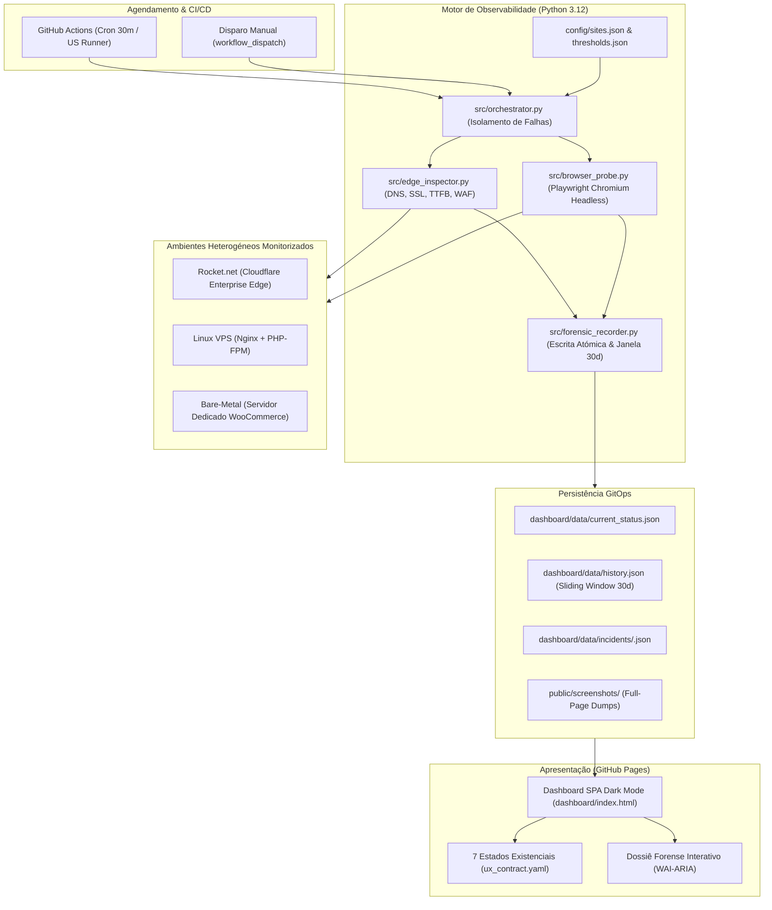

# Sentinel — Plataforma de Observabilidade Sintética E-Commerce (Tier-S)

> **Plataforma ponta a ponta (E2E) de observabilidade sintética e diagnóstico forense para lojas WooCommerce/WordPress.**  
> Concebida com garantia de **Pegada Zero (*Zero-Footprint*)**, execução agendada a cada 30 minutos em runners sediados nos EUA (GitHub Actions), persistência GitOps deslizante de 30 dias e publicação automática de painel SPA Dark Mode no GitHub Pages a **custo zero de infraestrutura**.

---

## 1. Visão Geral e Princípio de Pegada Zero (*Zero-Footprint*)

Plataformas tradicionais de observabilidade em WordPress dependem frequentemente de plugins pesados ou rotinas de `wp-cron` que consomem CPU/RAM do servidor da loja e que deixam de funcionar precisamente quando o servidor sobreaquece ou entra em *kernel panic*.

A **Sentinel** adota uma abordagem cirúrgica externa:
- **Zero Plugins no WordPress:** Nenhum ficheiro PHP ou extensão é instalado no ambiente da loja.
- **Zero Impacto de CPU/RAM:** Todo o processamento computacional ocorre nos runners remotos do GitHub Actions.
- **Sonda a Partir dos EUA:** Testes sintéticos executados a partir de datacenters norte-americanos (`ubuntu-latest`, `en-US`, `America/New_York`), replicando o perfil geográfico real da maioria dos clientes e CDN edges.
- **Bypass WAF Seguro:** Suporte a cabeçalhos dedicados (`X-WAF-Bypass-Token`) para prevenir falsos positivos em firewalls como Cloudflare Enterprise e Rocket.net.

---

## 2. Arquitetura da Solução



---

## 3. Os Cinco Componentes Principais

### 1. Edge Inspector ([`src/edge_inspector.py`](src/edge_inspector.py))
- Resolução de latência DNS via sockets nativos.
- Validação de certificado SSL/TLS (contagem exata de dias restantes até expiração e deteção de certificados inválidos).
- Medição de TTFB (*Time to First Byte*) por streaming HTTP de baixo overhead.
- Injeção de token de bypass WAF (`X-WAF-Bypass-Token`).
- Classificação determinística de estado: `HEALTHY`, `DEGRADED` ou `CRITICAL`.

### 2. Motor Playwright de Sonda Forense ([`src/browser_probe.py`](src/browser_probe.py))
- Execução em Chromium com perfil de utilizador dos EUA (`en-US`, `America/New_York`, viewport 1440x900).
- Buffer forense ativo intercetando em tempo real:
  - Exceções e erros não tratados da página (`pageerror`);
  - Mensagens de erro da consola JavaScript (`console.error`);
  - Respostas HTTP com falha em endpoints WooCommerce (`/?wc-ajax=*` com status &ge; 400).
- Fluxo de checkout sintético estritamente de leitura (sem submissão de encomenda final):
  `PDP` $\to$ `Adicionar ao Carrinho` $\to$ `Página de Checkout` $\to$ `Tabela #order_review` $\to$ `Verificação de Frete Bloqueado` $\to$ `Presença de Gateways de Pagamento`.
- Captura de screenshots full-page e trechos de DOM em caso de quebra com geração de veredito de causa-raiz em Português.

### 3. Gravador Forense e Orquestrador ([`src/forensic_recorder.py`](src/forensic_recorder.py) e [`src/orchestrator.py`](src/orchestrator.py))
- Escrita de dados em disco com proteção atómica (`tempfile` + `os.replace`).
- Janela deslizante de 30 dias com poda automática (*garbage collection*), mantendo o repositório leve para GitOps contínuo.
- Cálculo estatístico automático de uptime, taxa de sucesso de checkout e TTFB médio ponderado.
- Isolamento total de falhas: uma anomalia na Loja A nunca interrompe a inspeção das Lojas B e C.

### 4. Painel Web de Gestão SPA Dark Mode ([`dashboard/`](dashboard/))
- Single Page Application estática e ultraleve em Vanilla HTML5, CSS3 moderno e ES6 assíncrono.
- Concebida sob o **Contrato Universal de UX ([`.harness/invariants/ux_contract.yaml`](.harness/invariants/ux_contract.yaml))**:
  - **7 Estados Existenciais:** `EMPTY`, `LOADING`, `POPULATED`, `ZERO_RESULTS`, `PARTIAL_DEGRADED`, `ERROR` e `SUCCESS_FEEDBACK`.
  - **Hierarquia de Ações:** Estritamente 1 CTA Primário no cabeçalho.
  - **Previsibilidade Comportamental:** Encerramento de modais com a tecla `Escape` e cancelamento idempotente (*Cancel is no-op*).
  - **Matemática Modular 4/8pt:** Espaçamentos e raios concêntricos rigorosos.
  - **Minigráficos SVG (Sparklines):** Visualização imediata da evolução da saúde nos últimos 30 dias.
  - **Modal de Investigação Forense:** Dossiê com visualizador de screenshots com zoom, terminal de erros JS e tabela de erros de rede.

### 5. Esteira CI/CD e Publicação no GitHub Pages ([`.github/workflows/sentinel_engine.yml`](.github/workflows/sentinel_engine.yml))
- Agendamento cron a cada 30 minutos em runners `ubuntu-latest`.
- Permissões restritas (`contents: write`, `pages: write`, `id-token: write`).
- Commit de telemetria com a flag `[skip ci]` para prevenir loops de execução.
- Deploy automático da pasta `dashboard/` no GitHub Pages.

---

## 4. Guia Rápido de Instalação e Implantação

### Passo 1: Configurar Segredos no Repositório GitHub
1. No seu repositório GitHub, aceda a **Settings** > **Secrets and variables** > **Actions**.
2. Adicione um novo Repository Secret:
   - **Nome:** `WAF_BYPASS_TOKEN`
   - **Valor:** Seu token secreto de bypass configurado no Cloudflare / Rocket.net (ou um valor aleatório seguro).

### Passo 2: Ativar o GitHub Pages
1. Aceda a **Settings** > **Pages**.
2. Na secção **Build and deployment** > **Source**, selecione:
   - **GitHub Actions**.

### Passo 3: Registar as Lojas a Monitorizar em [`config/sites.json`](config/sites.json)
Edite o ficheiro `config/sites.json` com os domínios das suas lojas:
```json
{
  "sites": [
    {
      "id": "minha-loja-rocket",
      "name": "Loja Principal Rocket.net",
      "url": "https://www.minhaloja.com",
      "infrastructure": "rocket_cloudflare",
      "pdp_sample_url": "https://www.minhaloja.com/produto/camisa-exemplo",
      "selectors": {
        "add_to_cart_button": ".single_add_to_cart_button",
        "cart_checkout_button": ".checkout-button",
        "order_review_table": "#order_review",
        "no_shipping_indicator": ".woocommerce-no-shipping-available-html",
        "payment_gateways_container": "#payment"
      }
    }
  ]
}
```

---

## 5. Execução e Testes em Ambiente Local

### Pré-requisitos
- Python 3.12+
- Virtualenv ativo

### 1. Instalar Dependências
```bash
pip install -r requirements.txt
playwright install chromium
```

### 2. Configurar Variáveis de Ambiente
```bash
cp .env.example .env
```

### 3. Executar a Suíte Completa de Testes Determinísticos
```bash
python -m unittest discover tests -v
```
*(Executa mais de 50 testes de conformidade de esquemas, motor forense, gravações atómicas e contratos de UX em ~0.15s)*.

### 4. Executar Ronda de Observabilidade Manualmente
```bash
# Execução completa com browser Chromium
python -m src.orchestrator

# Execução rápida (apenas inspeção de borda DNS/SSL/TTFB)
python -m src.orchestrator --skip-browser

# Filtrar por uma loja específica
python -m src.orchestrator --site minha-loja-rocket
```

### 5. Pré-visualizar o Painel Web Localmente
```bash
python -m http.server 8000 --directory dashboard
```
Abra o navegador em `http://localhost:8000` para explorar o painel SPA em Dark Mode.

---

## 6. Governação e AI Harness

Este projeto é governado pelo **AI Harness v6.4** ([`AGENTS.md`](AGENTS.md)), cumprindo invariantes arquiteturais rigorosas:
- **Canonical Path First:** Sem wrappers paralelos ou duplicação de regras.
- **Strict Schema:** Modelos tipados e validados via Pydantic v2 ([`src/models.py`](src/models.py)).
- **Universal UX Contract:** Auditoria determinística de acessibilidade e design tokens ([`.harness/invariants/ux_contract.yaml`](.harness/invariants/ux_contract.yaml)).
- **Universal Time Machine:** Snapshots atómicos antes de qualquer mutação em disco.
- **Evidence-Gated Completion:** Todas as tarefas são seladas por recibos criptográficos com hash SHA-256 no diretório `receipts/`.

---

## 7. Licença
Distribuído sob a licença MIT. Consulte `LICENSE` para mais detalhes.

